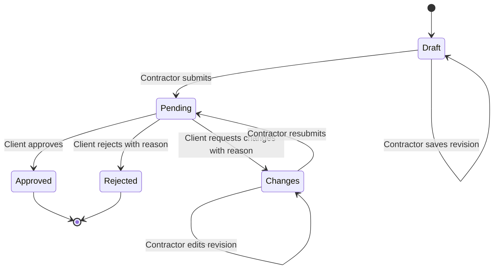
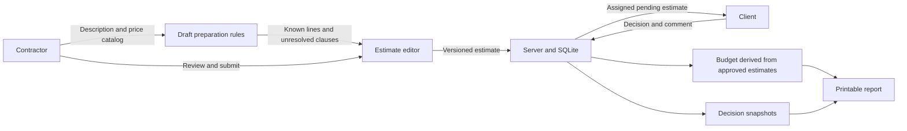
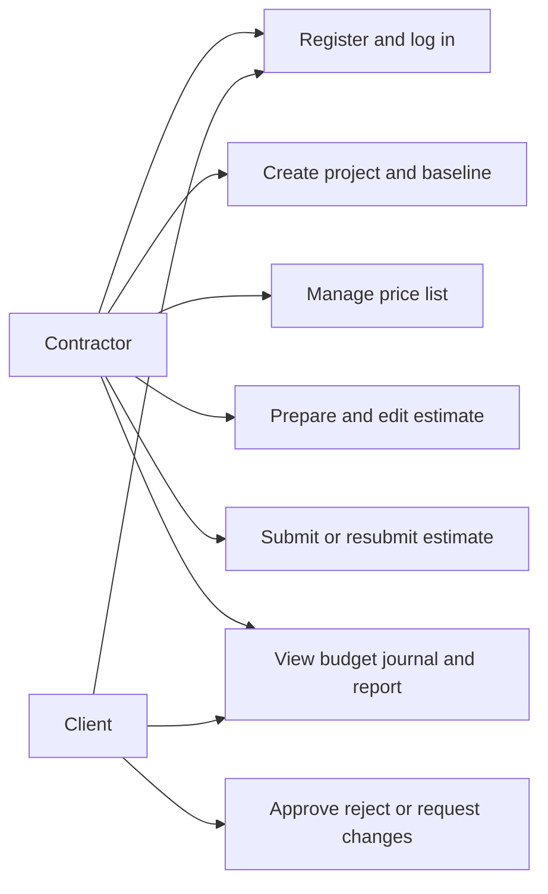
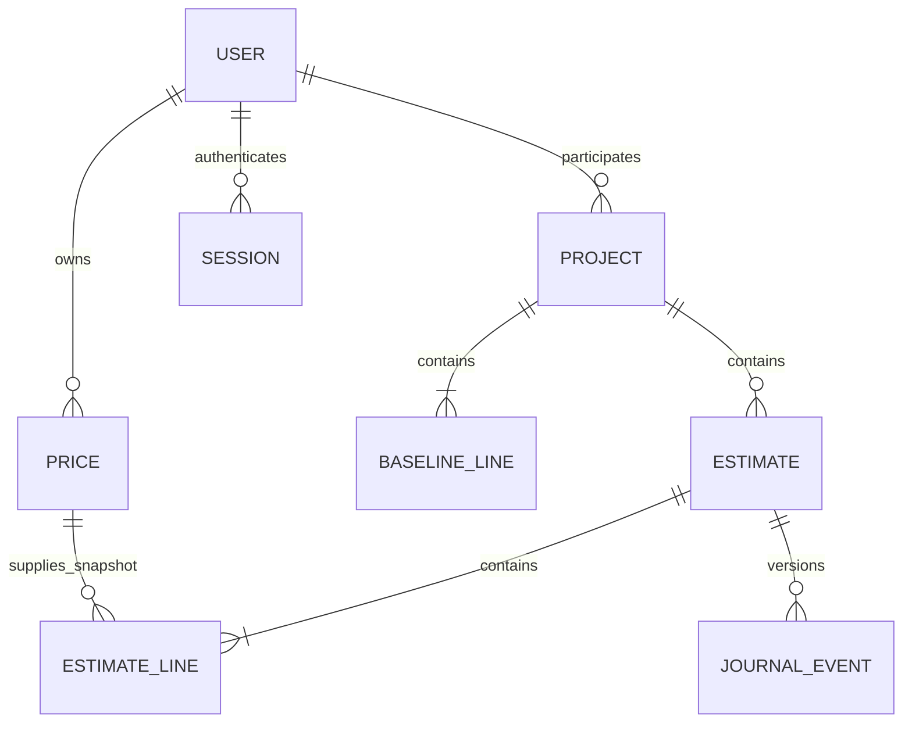

# RenoLock AI Software Requirements Specification

Version 1.0 · MVP · 17 October 2026

## 1. Introduction

### 1.1 Purpose

This SRS specifies the demonstrable RenoLock AI MVP: a renovation budget and change approval application for contractors and clients. The product prevents unapproved additional work estimates from increasing the approved project budget. It supports the Team Project 2 analysis and product demonstration.

### 1.2 Document Conventions

FR identifies functional requirements; NFR identifies nonfunctional requirements; BR identifies business rules; AC identifies acceptance scenarios. All listed FR requirements are MVP scope unless explicitly described as a limitation. Currency is KZT. A budget is an agreed cost plan, not money spent or a payment obligation enforced by the application.

### 1.3 Intended Audience and Reading Suggestions

Students and assessors should start with scope and acceptance scenarios; contractors and clients with user classes and workflow; developers with requirements, analysis models and implementation constraints. README provides operating instructions.

### 1.4 Product Scope

The application stores projects, a fixed initial estimate, contractor price lists and additional work estimates. A contractor prepares and reviews a draft, sends it to an assigned client, and receives approval, rejection or a request for changes. Approved changes increase the budget. A decision journal retains amounts, comments, actors and line snapshots. The MVP offers a deterministic assistant without an external AI API and an optional browser speech interface.

The full local server version provides registration, authentication and shared persistence. The hosted static demonstration is explicitly a single-browser sandbox without real authentication. It must not be represented as a deployed multi-tenant SaaS backend.

### 1.5 References

- Provided `Team project 2 template(1).doc`: SRS sections, system features, nonfunctional requirements and appendices.
- Provided `Table of contents for Team project 2(1).docx`: Introduction, Overall Description, External Interface Requirements, System Requirements, Nonfunctional Requirements and appendices A–C; Endterm/Final labels.
- Referenced conversation “Выбор идеи проекта”: initial scope, KZT examples and approval behavior.
- Available screenshots: four-screen concept (project dashboard, AI estimate draft, client decision, project finances) and text-to-price-list workflow. One PNG is blank.

The supplied table of contents places external interfaces before system requirements; this SRS uses that ordering. The generic “Dish State Diagram” appendix label is adapted to the estimate domain. This is an MVP specification, not a completed independent assessment of all grading criteria.

## 2. Overall Description

### 2.1 Product Perspective

RenoLock AI replaces scattered verbal and messenger agreements with versioned estimates and decisions. It is a standalone application. No messaging platform, banking system or external price database is integrated.

### 2.2 Product Functions

Account access; project creation and assignment; initial estimate; price list management and CSV import; text-to-draft preparation; manual editing; submission; client decisions; version history; budget overview; printable financial report; optional speech-to-text.

### 2.3 User Classes and Characteristics

| User | Capabilities |
|---|---|
| Contractor | Creates own projects, assigns registered clients, manages own catalog, prepares and edits drafts, submits estimates, views decisions and reports |
| Client | Views assigned projects and submitted estimates, approves/rejects/requests changes, views budget/history and reports |
| Host operator | Starts/stops the local service and manages the database file outside the application; not an in-app role |

Contractors need basic familiarity with construction quantities and units. Clients do not need estimating expertise but must review scope and amounts. A role is selected at registration and cannot be changed by the public API.

### 2.4 Operating Environment

Node.js 24+, SQLite supplied by Node, modern browser with ES modules, CSS grid and dialog support. Defaults to localhost HTTP on port 4173. Browser speech support varies; text remains fully functional. Hosted sandbox uses HTTPS and localStorage.

### 2.5 Design and Implementation Constraints

No mandatory paid API, external npm dependencies, CDN fonts or third-party runtime scripts. Price calculation is deterministic. Units supported by assistant/catalog: м², м and шт. Baseline accepts a descriptive unit such as этап. State is stored as a transactional JSON document in SQLite. A single local Node process is the intended deployment size. Shared-server requests require cookie authentication and role/project checks.

### 2.6 User Documentation

README contains installation, credentials, data location, environment settings, demo script, CSV schema, testing and limitations. The in-app “Как это работает” page explains workflow, pricing rules, AI mode and speech dependencies.

### 2.7 Assumptions and Dependencies

The client registers before project assignment. Demo data is synthetic. Contractor prices are user-supplied and do not assert market accuracy. The contractor confirms completeness of parsed work. Multiple users refresh manually to retrieve other users’ decisions. PDF saving depends on the browser print dialog. Speech may depend on an external browser provider and network connectivity.

## 3. External Interface Requirements

### 3.1 User Interfaces

Sign-in/registration; role-specific dashboard; project list/search and project detail; price list and CSV import dialog; estimate editor; submitted estimate decision view; journal with snapshot disclosure; project financial report. Green identifies approved actions; amber identifies pending items. Status text accompanies color. Small screens use a menu and stacked cards; wide tables scroll within their containers.

User input is escaped before HTML insertion. Forms provide labelled inputs, keyboard focus outlines and error messages. Decisions show clear state and totals. Approval includes a confirmation dialog showing the amount and resulting budget.

### 3.2 Hardware Interfaces

Keyboard/touch/pointer for normal interaction. Optional microphone for speech. No specialised construction equipment or sensors.

### 3.3 Software Interfaces

Node HTTP server, node:sqlite, node:crypto, browser fetch, browser print, optional SpeechRecognition or webkitSpeechRecognition. Static sandbox uses the same business-rules module with localStorage and sessionStorage. No LLM endpoint is configured.

### 3.4 Communications Interfaces

Same-origin JSON endpoints: GET `/api/health`, POST `/api/auth`, POST `/api/logout`, GET `/api/state`, POST `/api/action`. State is scoped to the authenticated user. POST bodies require application/json. A supplied cross-origin Origin header is rejected. HttpOnly/SameSite cookies limit browser credential exposure; HTTPS deployments enable Secure cookies. No email, SMS or real-time sockets.

## 4. System Requirements

| ID | Requirement | Acceptance evidence |
|---|---|---|
| FR-01 | Register a named Contractor or Client with unique email and password of 10–200 characters; authenticate and revoke session on logout | API integration test |
| FR-02 | Limit projects, estimates, catalogs and journal access by user role and project membership | Domain and API tests |
| FR-03 | Contractor creates project with registered Client email, address, area and nonempty positive initial estimate | Domain test and project UI |
| FR-04 | Calculate initial budget from rounded line amounts; baseline remains fixed through the application API | Core model and read-only baseline UI |
| FR-05 | Contractor creates/updates/archives own price entries and imports the documented simple CSV format | Price UI; catalog domain tests |
| FR-06 | Prepare draft lines by matching each text clause to exactly one active contractor price item and one explicit positive quantity/unit | Parser tests |
| FR-07 | Return unresolved clauses without invented price or propagated quantities; show them for manual review | Unknown/ambiguous/missing quantity tests |
| FR-08 | Contractor edits draft/changes estimates; catalog-based lines retain a catalog price snapshot and any override reason | Override and negative-input tests |
| FR-09 | Saving a draft and submitting it are separate explicit actions | Browser workflow |
| FR-10 | Only assigned Client can approve, reject or request changes to a pending estimate; rejection/change request requires a comment | Domain/API tests |
| FR-11 | Change requests unlock editing and resubmission; terminal decisions lock editing | Workflow tests |
| FR-12 | Persist actor, time, revision, amount, comment and line snapshot for creation, edits and transitions | Snapshot tests and journal |
| FR-13 | Budget equals initial amount plus approved estimate totals; other statuses are excluded | Budget tests |
| FR-14 | Refuse stale or repeated decisions; save transition and journal atomically | Concurrent API and stale revision tests |
| FR-15 | Show dashboard, project breakdown, pending amounts, filters and searchable projects | Browser/UI review |
| FR-16 | Produce a printable project report including baseline, visible changes and decision history | Report screen and print stylesheet; browser saves PDF |
| FR-17 | Provide optional user-triggered speech input and text fallback where unavailable or denied | Feature detection/error handlers; live recognition not guaranteed |
| FR-18 | Clearly label non-LLM mode and distinguish local shared backend from hosted browser sandbox | UI notices and README |

### Business Rules

- BR-01: `current budget = total(initial lines) + Σ total(approved estimates)`.
- BR-02: Round each `quantity × unit price` to 0.01 KZT before summing line amounts. All quantities and prices must be finite and positive.
- BR-03: `draft → pending`; `pending → approved | rejected | changes`; `changes → pending`. Saving draft/changes increments revision but preserves status. Approved/rejected are terminal.
- BR-04: Prices for previously submitted or decided estimates are snapshots; a later catalog edit cannot change an approved amount. Saving an editable draft validates against the current catalog; a differing price requires a reason.
- BR-05: An inactive/missing catalog item cannot be used for a newly saved draft. Unknown description text is never assigned an estimated market price.
- BR-06: A project’s contractor and assigned client have separate responsibilities; a contractor cannot approve their own submitted estimate.
- BR-07: Decision requests carry a revision. Mismatch or illegal transition is rejected; there is no additive budget update to apply twice.
- BR-08: A manually acknowledged unresolved-description notice is a review aid, not proof that scope is complete. Server validates line provenance and numeric values independently.

### Acceptance Scenarios

AC-01: Given the seeded catalog, “Выровнять 20 м2 стен; грунтовка 20 м2” produces 50,000 and 8,000 KZT, total 58,000. “Установить бассейн 1 шт” produces an unresolved item and no price.

AC-02: Given initial 2,400,000 and already approved 21,000, a pending 58,000 estimate leaves current budget at 2,421,000. Client approval changes it to 2,479,000. A duplicate request cannot change it again.

AC-03: A client requests changes with a reason, contractor edits quantities to 10 and resubmits 29,000. The old 20 m² snapshot remains visible. Budget rises to 2,450,000 only after approval.

AC-04: A second unrelated registered client sees zero assigned projects and cannot access or decide another client’s estimate via API.

AC-05: Restart the Node server with the same data directory. Accounts, valid sessions, projects, decisions and amounts remain in SQLite.

## 5. Nonfunctional Requirements

### Security and Privacy

NFR-01: Passwords stored as scrypt hashes with random salts; session secrets stored as SHA-256 digests. Cookies use HttpOnly, SameSite=Strict and optional Secure. Session lifetime is 24 hours. Authentication endpoints use a simple per-address attempt limit.

NFR-02: Every state read and business mutation checks server-side role and project membership. Parameterised SQLite statements avoid SQL string interpolation. Static file paths are explicitly allowlisted. CSP, no-sniff, frame and referrer headers are sent by the local server. User data is HTML-escaped.

NFR-03: The demonstration sandbox carries no security promise. Its storage is local and user-editable. Neither administrator-proof audit nor legally binding approval/e-signature is claimed.

### Reliability and Data Integrity

NFR-04: Domain mutation and corresponding journal entry commit together in a SQLite transaction. Rollback preserves the previous state on validation failure. Revisions reject stale decisions and edits. Approved amounts are derived from records.

NFR-05: Unknown work, missing quantity, parser ambiguity and unsupported microphone must produce explanatory UI. Speech is optional. A disconnected API reports a connection error without silently changing a live session into offline demo mode.

### Usability and Accessibility

NFR-06: Responsive CSS for narrow/wide screens, labelled inputs, readable text statuses, keyboard-operable native controls/dialogs, confirmation before approval and explicit saving/submission steps. Full WCAG audit is outside validated scope.

### Performance and Capacity

NFR-07: No external UI dependencies, build step or AI network call in the core workflow. Maximum 100 lines per estimate and 1 MB API request body. CSV import up to 100 rows/100 KB. Whole-state JSON persistence is appropriate for demonstrations; no production concurrency/latency SLA is asserted.

### Maintainability and Portability

NFR-08: Common pure domain module runs in Node and browser sandbox; Node built-in test runner covers business rules and HTTP integration. Runtime requirement and data migration limits are documented. Desktop modern browsers are the primary target; voice provider support is independent.

## Appendix A Glossary

Baseline: fixed initial estimate. Change estimate: additional proposed work. Draft: contractor-only editable estimate. Pending: submitted version awaiting client decision. Approved: accepted amount included in budget. Changes: client requested revision. Catalog: contractor price list. Snapshot: line data retained for a particular journal event. Rules mode: deterministic matching without an LLM. SaaS: intended subscription delivery model, with billing outside this MVP.

## Appendix B Analysis Models

### Estimate State Diagram

### Data Flow Diagram

### Use Case Diagram

### Logical Data Model

Logical entities are nested inside the SQLite `state` JSON; `credentials` and `sessions` are separate SQLite tables. The ER diagram describes relationships, not a claim of a fully normalised physical schema.

## Appendix C Issues List

| Issue | MVP decision / future work |
|---|---|
| Real generative AI | Not connected; add a server-side adapter only after provider choice, budget and validation policy are agreed |
| Free text completeness | Rules can miss descriptions; explicit unresolved list and human review remain mandatory |
| SaaS deployment | Static hosted demo only; full Node/SQLite backend runs locally, separate server hosting needed |
| Account lifecycle | No email verification, invitations, password reset or in-app role changes |
| Initial agreement | Baseline treated as recorded starting contract; no separate baseline approval/e-signature workflow |
| Communication | In-app status and manual refresh; email/push notifications not included |
| Speech | Browser-dependent, provider/network-dependent, microphone consent required; not validated as universally available |
| PDF | Browser print-to-PDF, no automatic server-generated downloadable file |
| Scale and recovery | No load SLA, scheduled backups, per-entity SQL migration or administrative audit signing |
| Pricing model | SaaS subscription business hypothesis; billing, willingness-to-pay and pricing research remain future work |
