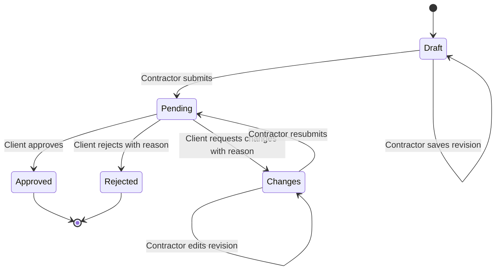
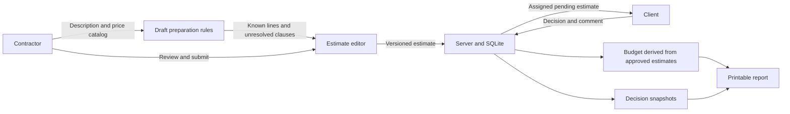
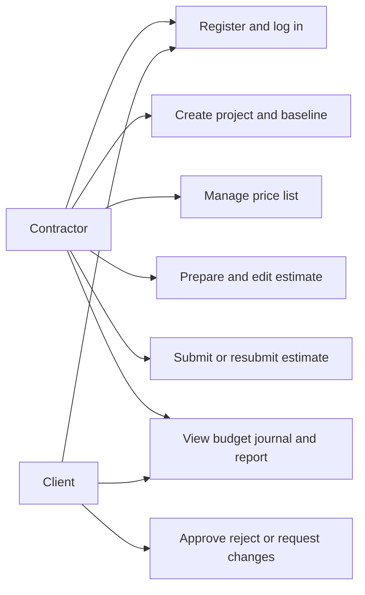
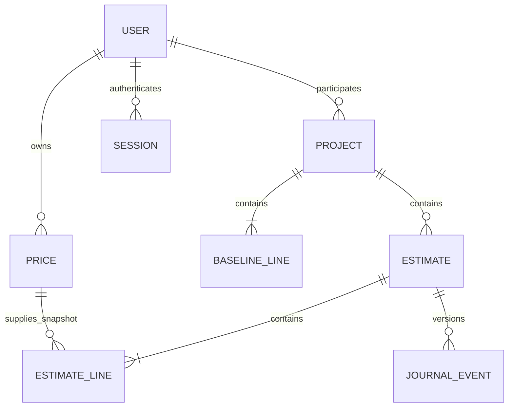

# RenoLock AI Software Requirements Specification

Version 1.8 · MVP · 24 October 2026

## Current release 1.8 — private chat attachments

FR-45: Each chat message may reference 0–3 unique uploaded attachment IDs, with up to 5 MiB per file. Supported extensions: JPG/JPEG, PNG, WebP, PDF, DOCX, XLSX, TXT, CSV. Upload validates name, size and basic magic bytes; SVG/HTML/executable formats are excluded. A message may contain attachments without text. Sender may attach only own uploads belonging to the same project. Retry identity includes attachment IDs.

FR-46: Cloud binaries use a private Sites R2 binding BUCKET; D1 state stores metadata and message associations. Private GET checks a registered, unblocked client/contractor who belongs to the project and either owns the pending upload or can read a message referencing it. Staff and unrelated users receive no attachment metadata or binary access. No public bucket URL is exposed. Documents are downloads; supported raster images have inline previews. Responses are private/no-store, nosniff and sandboxed. Completed projects allow historical reads, not new uploads.

FR-47: The local SQLite server provides equivalent protected endpoints and hashed storage paths under data/uploads. The browser demo uses localStorage, without cross-device guarantees. UI retains selected upload IDs for send retries, polls new file metadata with messages, and preserves draft text. New attachment messages trigger existing private chat notifications. Uploaded binaries are removed if their metadata CAS write fails; orphan recovery after process crashes is not guaranteed. Pending-upload cap: 30 per user. No antivirus scanner, scheduled retention cleanup or full Office package validation is implemented.

Validation: 62 tests and browser confirmation of upload, message attachment and image preview. Existing messages, project budgets, schedule/acceptance decisions and file membership rules are preserved. Earlier statements that attachments are unavailable are superseded by this release.

## Current release 1.7 — private project messaging

FR-42: The client and contractor assigned to a project may exchange plain-text messages of 1–2000 characters. Author identity and timestamp are set by the server, ignoring submitted author fields. API state filters messages by actual participant membership; staff and other users receive no chat records. Message text is escaped for display and rendered without HTML execution. Completed project chats are read-only.

FR-43: Successful message creation and a notification to the other participant are saved atomically in application state. A stable per-sender/project clientMessageId makes retries idempotent; reuse with changed text is rejected. The sender is not self-notified and staff receive no message notification. Opening a chat marks its recipient's chat notifications read. Notification links open the relevant project chat.

FR-44: The open workspace polls messages every 20 seconds and supports manual refresh. Updating the message list preserves the compose field and reading scroll position unless already at the bottom. There are no push/email deliveries, attachments or interpersonal read receipts. User-authored messages are not translated when switching RU/KK/EN. Chat messages do not alter budget, dates, financial approvals or acceptance.

Validation: 58 tests, including persistence, recipient privacy, staff exclusion, author-spoofing rejection, invalid-size rejection, duplicate prevention and read-only completed chats. Historical communication descriptions below are superseded by FR-42–FR-44.

## Current release 1.6 — scheduling, acceptance and notifications

FR-39: Both baseline project work and each approved additional estimate have a separate schedule with proposed/approved start and end dates. Contractor proposals require a reason and a current schedule version. Dates must be valid YYYY-MM-DD calendar dates with start ≤ end. Only the assigned client decides; rejection requires a reason. A new proposal does not overwrite agreed dates. Proposals and decisions are retained in history. Calendar lateness is calculated against the current agreed end date in Asia/Qyzylorda (UTC+5); accepted work is not shown as currently overdue. There is no scheduled reminder service.

FR-40: Contractor submits baseline or approved extra work with a nonempty completion report, agreed dates and no pending date proposal. Acceptance is versioned: awaiting → accepted or changes; changes requires client remarks and permits contractor correction/resubmission. Only the assigned client decides. Awaiting/accepted work rejects execution updates and new date proposals. Accepted work is immutable through these operations. Financial approval and budget remain unchanged. Project closure requires client acceptance of baseline and every approved extra estimate, plus terminal approval workflows. Done alone never implies acceptance. Previous data is preserved without manufacturing historical client acceptance.

FR-41: Successful marketplace, financial-decision, progress, schedule and acceptance mutations append recipient-specific in-app notifications in the same persisted state transaction. Actor is not self-notified. Project participants and assigned manager receive relevant events; access-revoked records are filtered from view. Notifications support private read/all-read and navigation to project, estimate or requests. Failed/stale mutations produce no event. The open workspace polls every 20 seconds; notification polling does not replace in-progress forms. Email/SMS/push and offline delivery are outside this release.

Validation: 55 automated tests. New acceptance criteria cover calendar validation, authority boundaries, stale decision rejection, retained dates on rejected transfers, corrections and resubmission, no budget change, notification ownership/persistence, and full marketplace-to-review flow. The browser verified contractor proposals, client agreement, unread delivery and client correction requests on the local server.

The following release sections describe historical behavior. Current 1.6 requirements supersede statements that client work acceptance, notifications and agreed dates are future features.

## Current release 1.5 — supersedes historical deployment/AI descriptions below

The hosted production Site runs a Cloudflare Worker with a provisioned D1 binding. Authentication uses Sites Sign in with ChatGPT, followed by name and Client/Contractor onboarding. The API uses verified dispatch identity, not a submitted email. Browser demo data remains separate. No public privileged account creation is allowed. A real cloud administrator has not yet been provisioned. The local Node/SQLite server remains available separately.

FR-35: Approved estimates have a separate execution status: not_started, in_progress, delayed, done. Only the assigned contractor may update this status, with optimistic execution-version checking. Delayed requires integer delayDays from 1 to 3650 and a nonempty reason. History retains actor, time, reason and prior updates. Delay days are contractor-reported, not automatically calculated from a contractual deadline. Execution never changes financial approval or amount. Clients and assigned staff can read progress. Completed projects reject further progress changes.

FR-36: A client cannot close a project while additional estimates have unresolved approval states or approved work is not marked done. Contractor-reported completion is separate from client project completion; per-work client acceptance/dispute is future scope.

FR-37: Contractor-only project finances store cumulative plannedCost, actualCost and received, each from 0 to 1 billion KZT. Saving replaces totals. Planned profit equals approved contract value minus plannedCost. Cash balance equals received minus actualCost. Receipt progress uses approved contract value and caps the visual bar at 100%, while retaining any overpayment in numeric values. Pending changes are excluded. Client/staff responses and shared reports exclude private finances. No bank connection or transaction ledger is implied.

FR-38: Optional free local generative AI uses WebLLM 0.2.79 and Qwen2.5-0.5B-Instruct-q4f16_1-MLC in a WebGPU-compatible browser after explicit model-download action. It classifies work clauses against active own-catalog IDs; code extracts explicit quantities and assigns catalog prices. Invalid IDs, quantities, units and duplicates are excluded. All results require manual review before saving/sending; model failure does not silently claim successful AI inference. Rules/manual mode remains available. Model download is several hundred MB; device compatibility, output quality and availability are not guaranteed. No paid model API is called.

BR-10: Financial approval, execution and payments are separate concepts. Approved does not mean executed or paid; done does not mean client acceptance. Contractor private figures do not modify the shared budget.

Business analysis, stakeholder needs, requirement traceability and ideal role journeys are provided in `../RenoLock-Business-Analysis.md`. Validation at this release includes 49 automated tests; browser evidence and local-model verification are described in the delivery notes. Historical version descriptions below describe their respective earlier releases.

## Version 1.3 Platform Staff

FR-30: Manager and Administrator have dedicated role-based dashboards, demo entry points and RU/KK/EN UI. Public account creation remains limited to Client and Contractor. Real staff privileges are enforced by the server; online sandbox staff entry remains explicitly demonstrative.

FR-31: Administrators assign active managers to projects or remove assignments. A manager only reads assigned projects, submitted/terminal estimates and requests already linked to those projects. A manager cannot access another manager’s projects, contractor draft estimates or the platform account list. Administrators can inspect platform records including drafts for oversight.

FR-32: Staff may manage operational stages, create tasks with a valid due date and change task status, and add internal notes on accessible projects. Staff notes/tasks are not included in the Client/Contractor payload. Stages do not approve a financial estimate, change a baseline or affect budget derivation. Notes and tasks are operational records and do not attest actual payment or inspection.

FR-33: Administrators can block/unblock non-administrator accounts with a reason. Server sessions for the affected account are revoked. Login, reads and writes by blocked users are rejected. A free account without project/request participation or a professional profile may become a Manager or return to Client. Self-administration and administrator-role grants via these mutations are prohibited.

FR-34: Administrators hide/restore profiles and reviews with a reason, preserving original records. Hidden profiles and blocked providers are excluded from discovery and new requests; hidden reviews do not affect displayed ratings. Owner edits cannot undo administrator moderation. Staff audit records actor, time, operation, target, reason, and before/after values. This is application-level audit persistence, not cryptographic tamper protection.

BR-09: Staff must not execute Contractor/Client financial mutations. Only the assigned client can approve additional expenses. The pre-existing approved-budget equation is unchanged. Staff public-registration escalation attempts are rejected.

Validation: 41 tests pass, including HTTP staff authentication, rejection of public Admin signup, session invalidation on blocking/role change, assignment boundaries, moderation visibility, nonpublic notes, and refusal of staff financial decisions. Browser QA confirmed manager stage changes do not alter the displayed budget and appear in the administrator audit.

## Version 1.2 Language Support

FR-27: The interface supports Russian, Kazakh and English. A persistent language selector is available on authentication pages, workspaces and dialogs. Local selection is stored in the browser. Translation covers interface labels, navigation, filters, workflow statuses, hints, decision dialogs, validation messages and report headings. Stored project names, addresses, profile descriptions, reviews and other author text are not machine-translated.

FR-28: Switching languages must preserve in-progress form values and canonical filter/option/API values. Language switching changes presentation without rebuilding forms. Catalog calculations and approval permissions do not depend on the display language. The document language and accessible labels follow the selection.

FR-29: The standard sample work catalog accepts supported Russian, Kazakh and English phrases and quantity units. Custom work still relies on contractor-provided aliases. Speech recognition requests ru-RU, kk-KZ or en-US and retains browser-provider availability constraints. Unknown work and missing quantities must still be refused in every supported language.

Validation: 32 tests pass. Browser checks verified all three authentication/catalog languages, filtering after translation and retention of a request title and renovation class while switching languages inside a dialog.

## Version 1.1 Marketplace Extension

The platform now supports finding a contractor before a project exists. Existing budget and estimate rules remain in force. Contractor profiles expose a provider type (team or specialist), city, specialty, supported repair classes, indicative KZT/m² rate, supported area range, years of experience, portfolio and reviews. Indicative prices represent the named specialty and must not imply equal scope across professions. Seeded profiles and reviews are labelled synthetic.

| ID | Added requirement | Validation |
|---|---|---|
| FR-19 | Search and filter active profiles by city, provider type, specialty, repair class, maximum indicative rate and area; sort by experience/rate/rating | Domain filter test |
| FR-20 | Contractor edits only own public profile and adds portfolio entries with optional limited PNG/JPEG/WebP data | Owner and image validation tests |
| FR-21 | Client sends a scoped request with address, area, class, description and target budget | Domain request tests |
| FR-22 | Selected contractor sends a detailed initial estimate and conditions | Role and request tests |
| FR-23 | Client accepts a quoted request once; atomically create a project with selected contractor and a snapshot of the accepted baseline | Acceptance and duplicate tests |
| FR-24 | Requests, proposals and their history remain private to the two participants | Isolation tests |
| FR-25 | Client marks a joint project completed only after all additional estimates reach a terminal state, then may submit one rating/review | Completion and review tests |
| FR-26 | Existing SQLite and browser data receive an idempotent extension without resetting original projects/budgets | Migration test |

Request state: requested → quoted → accepted; requested/quoted → declined. Each mutation requires the current revision. Accepted/declined are terminal. Accepting the initial proposal creates the baseline; later changes require the existing estimate approval workflow. Marketplace is discovery and agreement recording, not a payment or legally binding signature service.

Reviews have a score from 1 to 5 and nonempty text. Synthetic example reviews are distinguishable from reviews tied to a completed project. This is application verification of project membership/completion, not external identity, certification or quality verification. A client completion marker is not evidence of independent inspection. Portfolio files are stored inline in MVP state; there is no photo moderation service.

New logical entities: ProviderProfile belongs to Contractor; PortfolioEntry belongs to ProviderProfile; ServiceRequest links Client and Contractor and may create one Project; Review links a completed Project, Client and ProviderProfile. Public catalog/review data is separate from private request/project payloads.

Validation for this update: 26 domain tests pass, plus JavaScript syntax checks. HTTP/browser validation could not be repeated because local network connections are blocked in the execution environment. Source publication is contingent on access to the Sites Git endpoint. The new offline HTML is a single-browser sandbox with the same stated limitations as hosted static mode.

## 1. Introduction

### 1.1 Purpose

This SRS specifies the demonstrable RenoLock AI MVP: a renovation budget and change approval application for contractors and clients. The product prevents unapproved additional work estimates from increasing the approved project budget. It supports the Team Project 2 analysis and product demonstration.

### 1.2 Document Conventions

FR identifies functional requirements; NFR identifies nonfunctional requirements; BR identifies business rules; AC identifies acceptance scenarios. All listed FR requirements are MVP scope unless explicitly described as a limitation. Currency is KZT. A budget is an agreed cost plan, not money spent or a payment obligation enforced by the application.

### 1.3 Intended Audience and Reading Suggestions

Students and assessors should start with scope and acceptance scenarios; contractors and clients with user classes and workflow; developers with requirements, analysis models and implementation constraints. README provides operating instructions.

### 1.4 Product Scope

The application stores projects, a fixed initial estimate, contractor price lists and additional work estimates. A contractor prepares and reviews a draft, sends it to an assigned client, and receives approval, rejection or a request for changes. Approved changes increase the budget. A decision journal retains amounts, comments, actors and line snapshots. The MVP offers a deterministic assistant without an external AI API and an optional browser speech interface.

The full local server version provides registration, authentication and shared persistence. The hosted static demonstration is explicitly a single-browser sandbox without real authentication. It must not be represented as a deployed multi-tenant SaaS backend.

### 1.5 References

- Provided `Team project 2 template(1).doc`: SRS sections, system features, nonfunctional requirements and appendices.
- Provided `Table of contents for Team project 2(1).docx`: Introduction, Overall Description, External Interface Requirements, System Requirements, Nonfunctional Requirements and appendices A–C; Endterm/Final labels.
- Referenced conversation “Выбор идеи проекта”: initial scope, KZT examples and approval behavior.
- Available screenshots: four-screen concept (project dashboard, AI estimate draft, client decision, project finances) and text-to-price-list workflow. One PNG is blank.

The supplied table of contents places external interfaces before system requirements; this SRS uses that ordering. The generic “Dish State Diagram” appendix label is adapted to the estimate domain. This is an MVP specification, not a completed independent assessment of all grading criteria.

## 2. Overall Description

### 2.1 Product Perspective

RenoLock AI replaces scattered verbal and messenger agreements with versioned estimates and decisions. It is a standalone application. No messaging platform, banking system or external price database is integrated.

### 2.2 Product Functions

Account access; project creation and assignment; initial estimate; price list management and CSV import; text-to-draft preparation; manual editing; submission; client decisions; version history; budget overview; printable financial report; optional speech-to-text.

### 2.3 User Classes and Characteristics

| User | Capabilities |
|---|---|
| Contractor | Creates own projects, assigns registered clients, manages own catalog, prepares and edits drafts, submits estimates, views decisions and reports |
| Client | Views assigned projects and submitted estimates, approves/rejects/requests changes, views budget/history and reports |
| Host operator | Starts/stops the local service and manages the database file outside the application; not an in-app role |

Contractors need basic familiarity with construction quantities and units. Clients do not need estimating expertise but must review scope and amounts. A role is selected at registration and cannot be changed by the public API.

### 2.4 Operating Environment

Node.js 24+, SQLite supplied by Node, modern browser with ES modules, CSS grid and dialog support. Defaults to localhost HTTP on port 4173. Browser speech support varies; text remains fully functional. Hosted sandbox uses HTTPS and localStorage.

### 2.5 Design and Implementation Constraints

No mandatory paid API, external npm dependencies, CDN fonts or third-party runtime scripts. Price calculation is deterministic. Units supported by assistant/catalog: м², м and шт. Baseline accepts a descriptive unit such as этап. State is stored as a transactional JSON document in SQLite. A single local Node process is the intended deployment size. Shared-server requests require cookie authentication and role/project checks.

### 2.6 User Documentation

README contains installation, credentials, data location, environment settings, demo script, CSV schema, testing and limitations. The in-app “Как это работает” page explains workflow, pricing rules, AI mode and speech dependencies.

### 2.7 Assumptions and Dependencies

The client registers before project assignment. Demo data is synthetic. Contractor prices are user-supplied and do not assert market accuracy. The contractor confirms completeness of parsed work. Multiple users refresh manually to retrieve other users’ decisions. PDF saving depends on the browser print dialog. Speech may depend on an external browser provider and network connectivity.

## 3. External Interface Requirements

### 3.1 User Interfaces

Sign-in/registration; role-specific dashboard; project list/search and project detail; price list and CSV import dialog; estimate editor; submitted estimate decision view; journal with snapshot disclosure; project financial report. Green identifies approved actions; amber identifies pending items. Status text accompanies color. Small screens use a menu and stacked cards; wide tables scroll within their containers.

User input is escaped before HTML insertion. Forms provide labelled inputs, keyboard focus outlines and error messages. Decisions show clear state and totals. Approval includes a confirmation dialog showing the amount and resulting budget.

### 3.2 Hardware Interfaces

Keyboard/touch/pointer for normal interaction. Optional microphone for speech. No specialised construction equipment or sensors.

### 3.3 Software Interfaces

Node HTTP server, node:sqlite, node:crypto, browser fetch, browser print, optional SpeechRecognition or webkitSpeechRecognition. Static sandbox uses the same business-rules module with localStorage and sessionStorage. No LLM endpoint is configured.

### 3.4 Communications Interfaces

Same-origin JSON endpoints: GET `/api/health`, POST `/api/auth`, POST `/api/logout`, GET `/api/state`, POST `/api/action`. State is scoped to the authenticated user. POST bodies require application/json. A supplied cross-origin Origin header is rejected. HttpOnly/SameSite cookies limit browser credential exposure; HTTPS deployments enable Secure cookies. No email, SMS or real-time sockets.

## 4. System Requirements

| ID | Requirement | Acceptance evidence |
|---|---|---|
| FR-01 | Register a named Contractor or Client with unique email and password of 10–200 characters; authenticate and revoke session on logout | API integration test |
| FR-02 | Limit projects, estimates, catalogs and journal access by user role and project membership | Domain and API tests |
| FR-03 | Contractor creates project with registered Client email, address, area and nonempty positive initial estimate | Domain test and project UI |
| FR-04 | Calculate initial budget from rounded line amounts; baseline remains fixed through the application API | Core model and read-only baseline UI |
| FR-05 | Contractor creates/updates/archives own price entries and imports the documented simple CSV format | Price UI; catalog domain tests |
| FR-06 | Prepare draft lines by matching each text clause to exactly one active contractor price item and one explicit positive quantity/unit | Parser tests |
| FR-07 | Return unresolved clauses without invented price or propagated quantities; show them for manual review | Unknown/ambiguous/missing quantity tests |
| FR-08 | Contractor edits draft/changes estimates; catalog-based lines retain a catalog price snapshot and any override reason | Override and negative-input tests |
| FR-09 | Saving a draft and submitting it are separate explicit actions | Browser workflow |
| FR-10 | Only assigned Client can approve, reject or request changes to a pending estimate; rejection/change request requires a comment | Domain/API tests |
| FR-11 | Change requests unlock editing and resubmission; terminal decisions lock editing | Workflow tests |
| FR-12 | Persist actor, time, revision, amount, comment and line snapshot for creation, edits and transitions | Snapshot tests and journal |
| FR-13 | Budget equals initial amount plus approved estimate totals; other statuses are excluded | Budget tests |
| FR-14 | Refuse stale or repeated decisions; save transition and journal atomically | Concurrent API and stale revision tests |
| FR-15 | Show dashboard, project breakdown, pending amounts, filters and searchable projects | Browser/UI review |
| FR-16 | Produce a printable project report including baseline, visible changes and decision history | Report screen and print stylesheet; browser saves PDF |
| FR-17 | Provide optional user-triggered speech input and text fallback where unavailable or denied | Feature detection/error handlers; live recognition not guaranteed |
| FR-18 | Clearly label non-LLM mode and distinguish local shared backend from hosted browser sandbox | UI notices and README |

### Business Rules

- BR-01: `current budget = total(initial lines) + Σ total(approved estimates)`.
- BR-02: Round each `quantity × unit price` to 0.01 KZT before summing line amounts. All quantities and prices must be finite and positive.
- BR-03: `draft → pending`; `pending → approved | rejected | changes`; `changes → pending`. Saving draft/changes increments revision but preserves status. Approved/rejected are terminal.
- BR-04: Prices for previously submitted or decided estimates are snapshots; a later catalog edit cannot change an approved amount. Saving an editable draft validates against the current catalog; a differing price requires a reason.
- BR-05: An inactive/missing catalog item cannot be used for a newly saved draft. Unknown description text is never assigned an estimated market price.
- BR-06: A project’s contractor and assigned client have separate responsibilities; a contractor cannot approve their own submitted estimate.
- BR-07: Decision requests carry a revision. Mismatch or illegal transition is rejected; there is no additive budget update to apply twice.
- BR-08: A manually acknowledged unresolved-description notice is a review aid, not proof that scope is complete. Server validates line provenance and numeric values independently.

### Acceptance Scenarios

AC-01: Given the seeded catalog, “Выровнять 20 м2 стен; грунтовка 20 м2” produces 50,000 and 8,000 KZT, total 58,000. “Установить бассейн 1 шт” produces an unresolved item and no price.

AC-02: Given initial 2,400,000 and already approved 21,000, a pending 58,000 estimate leaves current budget at 2,421,000. Client approval changes it to 2,479,000. A duplicate request cannot change it again.

AC-03: A client requests changes with a reason, contractor edits quantities to 10 and resubmits 29,000. The old 20 m² snapshot remains visible. Budget rises to 2,450,000 only after approval.

AC-04: A second unrelated registered client sees zero assigned projects and cannot access or decide another client’s estimate via API.

AC-05: Restart the Node server with the same data directory. Accounts, valid sessions, projects, decisions and amounts remain in SQLite.

## 5. Nonfunctional Requirements

### Security and Privacy

NFR-01: Passwords stored as scrypt hashes with random salts; session secrets stored as SHA-256 digests. Cookies use HttpOnly, SameSite=Strict and optional Secure. Session lifetime is 24 hours. Authentication endpoints use a simple per-address attempt limit.

NFR-02: Every state read and business mutation checks server-side role and project membership. Parameterised SQLite statements avoid SQL string interpolation. Static file paths are explicitly allowlisted. CSP, no-sniff, frame and referrer headers are sent by the local server. User data is HTML-escaped.

NFR-03: The demonstration sandbox carries no security promise. Its storage is local and user-editable. Neither administrator-proof audit nor legally binding approval/e-signature is claimed.

### Reliability and Data Integrity

NFR-04: Domain mutation and corresponding journal entry commit together in a SQLite transaction. Rollback preserves the previous state on validation failure. Revisions reject stale decisions and edits. Approved amounts are derived from records.

NFR-05: Unknown work, missing quantity, parser ambiguity and unsupported microphone must produce explanatory UI. Speech is optional. A disconnected API reports a connection error without silently changing a live session into offline demo mode.

### Usability and Accessibility

NFR-06: Responsive CSS for narrow/wide screens, labelled inputs, readable text statuses, keyboard-operable native controls/dialogs, confirmation before approval and explicit saving/submission steps. Full WCAG audit is outside validated scope.

### Performance and Capacity

NFR-07: No external UI dependencies, build step or AI network call in the core workflow. Maximum 100 lines per estimate and 1 MB API request body. CSV import up to 100 rows/100 KB. Whole-state JSON persistence is appropriate for demonstrations; no production concurrency/latency SLA is asserted.

### Maintainability and Portability

NFR-08: Common pure domain module runs in Node and browser sandbox; Node built-in test runner covers business rules and HTTP integration. Runtime requirement and data migration limits are documented. Desktop modern browsers are the primary target; voice provider support is independent.

## Appendix A Glossary

Baseline: fixed initial estimate. Change estimate: additional proposed work. Draft: contractor-only editable estimate. Pending: submitted version awaiting client decision. Approved: accepted amount included in budget. Changes: client requested revision. Catalog: contractor price list. Snapshot: line data retained for a particular journal event. Rules mode: deterministic matching without an LLM. SaaS: intended subscription delivery model, with billing outside this MVP.

## Appendix B Analysis Models

### Estimate State Diagram

### Data Flow Diagram

### Use Case Diagram

### Logical Data Model

Logical entities are nested inside the SQLite `state` JSON; `credentials` and `sessions` are separate SQLite tables. The ER diagram describes relationships, not a claim of a fully normalised physical schema.

## Appendix C Issues List

| Issue | MVP decision / future work |
|---|---|
| Real generative AI | Not connected; add a server-side adapter only after provider choice, budget and validation policy are agreed |
| Free text completeness | Rules can miss descriptions; explicit unresolved list and human review remain mandatory |
| SaaS deployment | Static hosted demo only; full Node/SQLite backend runs locally, separate server hosting needed |
| Account lifecycle | No email verification, invitations, password reset or in-app role changes |
| Initial agreement | Baseline treated as recorded starting contract; no separate baseline approval/e-signature workflow |
| Communication | In-app status and manual refresh; email/push notifications not included |
| Speech | Browser-dependent, provider/network-dependent, microphone consent required; not validated as universally available |
| PDF | Browser print-to-PDF, no automatic server-generated downloadable file |
| Scale and recovery | No load SLA, scheduled backups, per-entity SQL migration or administrative audit signing |
| Pricing model | SaaS subscription business hypothesis; billing, willingness-to-pay and pricing research remain future work |
